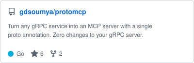
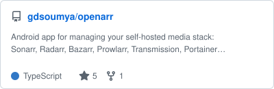
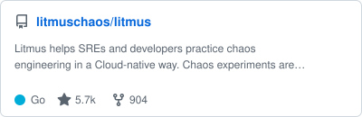
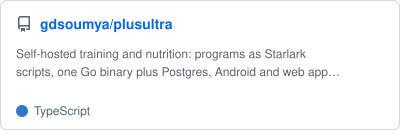
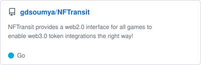

<!-- Your title -->
# Hi, I'm Soumya 👋

<!-- Your badges
You can use the website to generate badges: https://shields.io/
-->

 

<!-- Talking about you -->
## About me

- 🛠 Building cloud-native infrastructure and developer tooling in Go, with a focus on
  GitOps and continuous delivery ([Argo CD](https://github.com/argoproj/argo-cd)) and
  chaos engineering ([LitmusChaos](https://github.com/litmuschaos/litmus))
- 🤖 Working on LLM and agent infrastructure: gRPC-native Model Context Protocol servers
  ([protomcp](https://github.com/gdsoumya/protomcp)) and retrieval-augmented generation
  services ([rag-chat](https://github.com/gdsoumya/rag-chat))
- ⛓ Web3 background across DeFi protocol design, smart-contract engineering on EVM chains
  and cross-chain interoperability ([Ren](https://github.com/renproject))
- 📱 Self-hosting enthusiast: I build and run [OpenArr](https://github.com/gdsoumya/openarr),
  an Android app for managing the entire *arr media stack
- 💬 Happy to talk distributed systems, Kubernetes internals, site reliability and chaos
  engineering, DeFi architecture, or backend and API design

## Languages, Tools and Platforms
 

  
  
  
  
  
  
   
  
  
  
  
  
  

 

## Pinned Repositories
 
<!-- cards:start -->
<a href="https://github.com/argoproj/argo-cd"><picture><source media="(prefers-color-scheme: dark)" srcset="./cards/argoproj-argo-cd-dark.svg"></picture></a>&nbsp;&nbsp;&nbsp;&nbsp;&nbsp;&nbsp;
<a href="https://github.com/gdsoumya/protomcp"><picture><source media="(prefers-color-scheme: dark)" srcset="./cards/gdsoumya-protomcp-dark.svg"></picture></a>
  
<a href="https://github.com/gdsoumya/openarr"><picture><source media="(prefers-color-scheme: dark)" srcset="./cards/gdsoumya-openarr-dark.svg"></picture></a>&nbsp;&nbsp;&nbsp;&nbsp;&nbsp;&nbsp;
<a href="https://github.com/litmuschaos/litmus"><picture><source media="(prefers-color-scheme: dark)" srcset="./cards/litmuschaos-litmus-dark.svg"></picture></a>
  
<a href="https://github.com/gdsoumya/plusultra"><picture><source media="(prefers-color-scheme: dark)" srcset="./cards/gdsoumya-plusultra-dark.svg"></picture></a>&nbsp;&nbsp;&nbsp;&nbsp;&nbsp;&nbsp;
<a href="https://github.com/gdsoumya/NFTransit"><picture><source media="(prefers-color-scheme: dark)" srcset="./cards/gdsoumya-NFTransit-dark.svg"></picture></a>
<!-- cards:end -->
